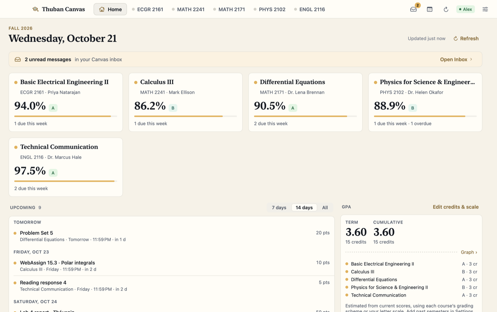
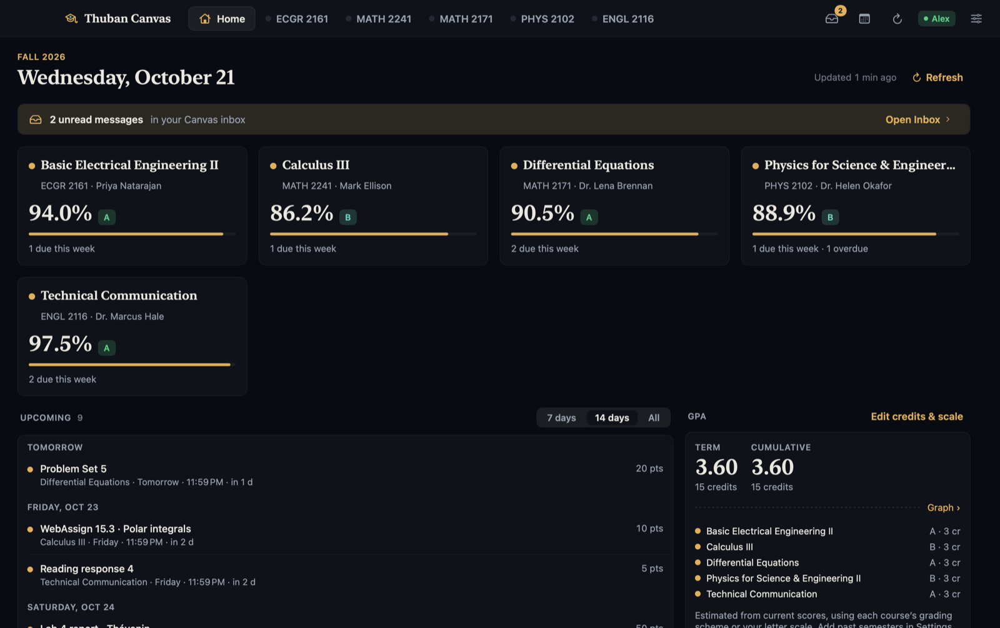
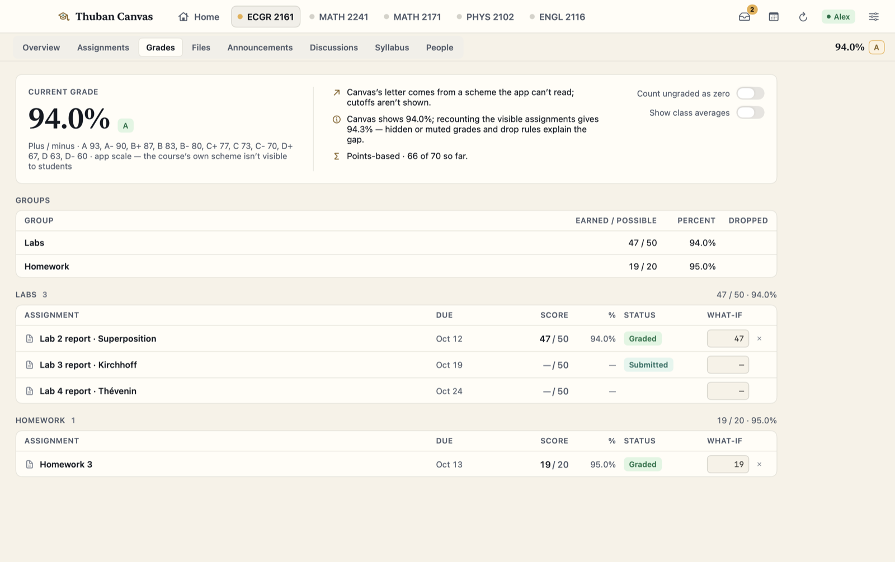
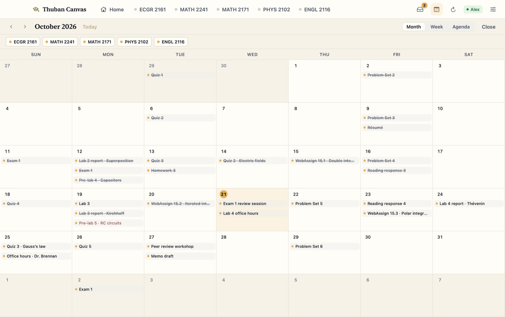
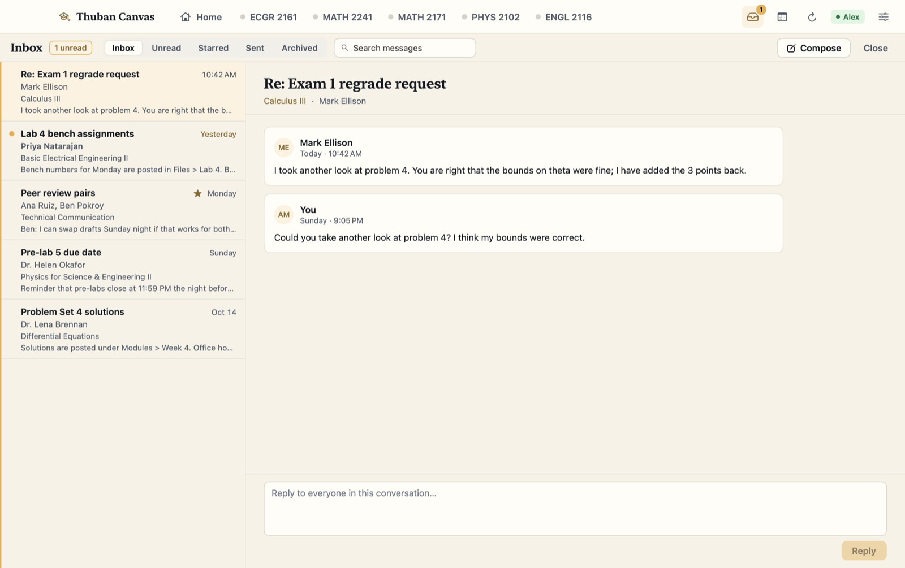
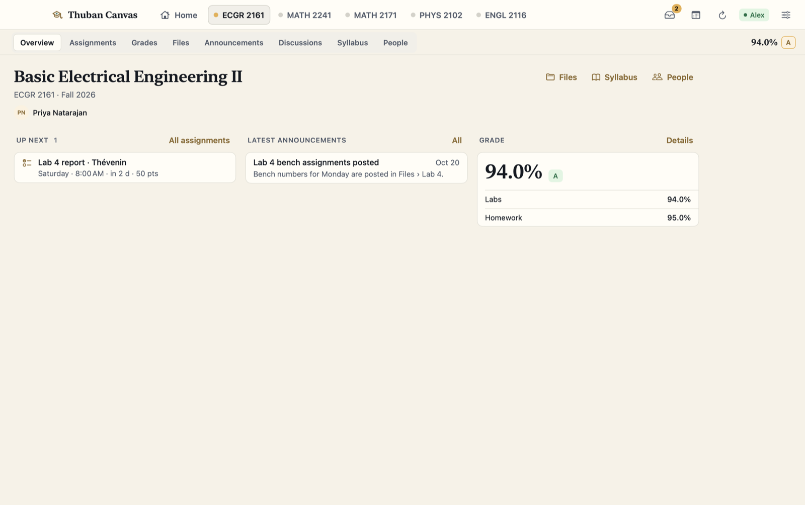
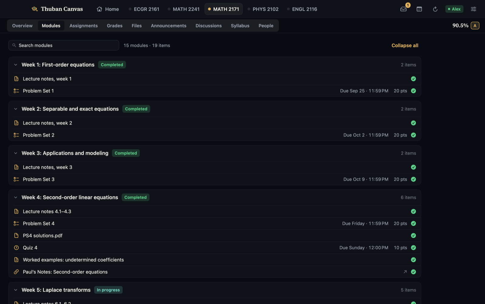

# Thuban Canvas

A calm, native macOS client for the Canvas LMS. Every course gets the same layout, and grades, GPA and deadlines from all your courses sit together on one Home screen.



## Why

The Canvas web app looks different in every course, because each instructor organizes their course their own way. Deadlines are spread across modules, calendars and to-do lists, and the grade it shows often leaves out how it was calculated. Thuban Canvas reads the same data through the Canvas REST API and gives every starred course the same set of sections. Home shows what is due, what is overdue and where you stand. Pages, files and messages open inside the app instead of in browser tabs.

## Features

**Home**
- Course cards with current score, letter grade, progress bar and how many items are due this week or overdue
- Upcoming list grouped by day (7 days / 14 days / all), with relative times such as "Tomorrow · 11:59 PM · in 1 d"
- Term and cumulative GPA estimated from current scores, with editable credits, letter scale, past semesters and a GPA history graph
- Unread-inbox banner and recent announcements across all courses

**Courses**
- Starred courses become tabs, each with the same sections: Overview, Modules, Assignments, Grades, Files, Pages, Announcements, Discussions, Syllabus, People. A section the course does not use is hidden.
- Grades view that redoes Canvas's arithmetic: assignment-group weights, drop rules, an optional "count ungraded as zero", plus/minus or custom letter cutoffs, and per-assignment **what-if** scores that are saved for each course
- An explanation whenever Canvas's displayed grade differs from the visible assignments (hidden or muted grades, drop rules)
- Searchable, collapsible modules with completion state, due dates and points
- PDFs shown with PDFKit, images shown natively, everything else in Quick Look, with "Open" and "Save to Downloads"
- Canvas HTML (pages, syllabus, announcements, discussions) displayed in a themed web view, with links routed back into the app

**Calendar and Inbox**
- Month, week and agenda calendar views with per-course filters; finished work is struck through
- A full Canvas inbox: Inbox, Unread, Starred, Sent and Archived, plus search, threaded conversations, reply and compose

**Mac integration**
- Menu bar item listing what is due next, what is overdue and the current grade in each course
- Due-date reminders, a morning overdue digest, alerts for new grades, announcements and messages, and a Dock badge
- Light and dark themes, several color schemes plus a custom one, a text-size control, a dyslexia-friendly font and a reduce-motion option

**Offline demo account**
- A built-in demo account (student "Alex", five courses with modules, grades, inbox, events and PDFs) runs with no network access and no Canvas account. All screenshots here come from it.

## Screenshots

<table>
  <tr>
    <td></td>
    <td></td>
  </tr>
  <tr>
    <td align="center">Home, dark mode</td>
    <td align="center">Grades with what-if scores</td>
  </tr>
  <tr>
    <td></td>
    <td></td>
  </tr>
  <tr>
    <td align="center">Calendar</td>
    <td align="center">Inbox</td>
  </tr>
  <tr>
    <td></td>
    <td></td>
  </tr>
  <tr>
    <td align="center">Course overview</td>
    <td align="center">Modules, dark mode</td>
  </tr>
</table>

## Built with

- Swift and SwiftUI, with AppKit where SwiftUI falls short (`NSStatusItem` for the menu bar, Quick Look previews)
- `WKWebView` for Canvas HTML, with a custom URL scheme handler that makes authenticated requests for embedded images and files
- PDFKit, Quick Look and UserNotifications
- An `actor`-based Canvas REST client with pagination, a disk cache that loads cached data first, and Codable models
- [XcodeGen](https://github.com/yonaskolb/XcodeGen) to generate the Xcode project from `project.yml`
- A local Swift package, `ThubanCanvasCore`, for networking, grade math, storage and theming. Its one third-party dependency is [SwiftSoup](https://github.com/scinfu/SwiftSoup), used to clean up and parse Canvas HTML.

## How it was built

I designed and directed this app: the product decisions, the feature set and the design rules. The code was written with [Claude Code](https://claude.com/claude-code) (AI-assisted). I reviewed and tested it on the offline demo account and on my own Canvas account.

## Architecture

- **`Packages/ThubanCanvasCore`** is a platform-neutral Swift package. It contains the Canvas client and endpoints, grade and GPA calculation, credential and settings storage, the demo account, and the theme engine. It has its own unit tests.
- **`AppModel`** is the root `@Observable` object. It holds the client, settings, cache, starred courses and the resources shared across courses. Each course gets a **`CourseSession`** that holds that course's modules, files, pages, discussions and grades.
- **`Resource<T>`** loads from the cache first and then from the network. It tracks loading, error, offline and "unavailable" states; a 403 or 404 response hides that section.
- **Views** use one shared set of components and theme tokens. No view contains a hard-coded color.
- **`CanvasiOS`** is an iPhone and iPad target (iOS 18+) in the same project. It reuses the core package and the platform-neutral app files. It is read-only: a request guard fails any request that is not a GET or HEAD before it is sent. It builds and runs in the simulator.

See [ARCHITECTURE.md](ARCHITECTURE.md) for the full layout, data flow and design rules.

## Getting started

**Requirements:** macOS 15 or later, Xcode 26, and XcodeGen (`brew install xcodegen`).

```sh
scripts/build.sh            # generates the Xcode project if needed, then makes a Debug build (ad-hoc signed)
scripts/test.sh             # unit tests for ThubanCanvasCore (swift test)
scripts/install.sh          # Release build, copied to /Applications/Thuban Canvas.app
```

To try it without a Canvas account, launch the Debug build on the demo account:

```sh
THUBAN_CANVAS_DEMO=1 ".build/DerivedData/Build/Products/Debug/Thuban Canvas.app/Contents/MacOS/Thuban Canvas"
```

`DEMO=1 scripts/smoke.sh` runs a visual smoke test on the demo account. It goes through Home, three courses, Calendar, Inbox and Settings and saves PNG screenshots.

For the iOS app, `scripts/ios_build.sh` makes an unsigned simulator build, `scripts/ios_install.sh` installs it in a simulator, and `scripts/ios_smoke.sh` takes demo-account screenshots on iPhone and iPad in light and dark mode.

After adding or removing source files, run `scripts/regen.sh` to regenerate the Xcode project.

### Connecting your Canvas account

The app needs your own Canvas personal access token. In Canvas, go to **Account → Settings → New Access Token**, then paste your school's Canvas address and the token into the app's Connect screen.

- The token is saved to `credentials.json` in the app's Application Support folder with `0600` (owner-only) permissions. The app does not use the Keychain, so launching it never asks for a password.
- The Mac app mostly reads. Every write is off unless you turn on **Allow sending to Canvas** in Settings. Writes include submitting, posting to a discussion, sending a message, replying, archiving and deleting. Irreversible writes also ask for confirmation in a sheet first. Marking messages read or unread and starring them happen immediately, as in the Canvas web inbox.
- The iOS app never writes to Canvas. Submitting and taking quizzes open in Safari.

## Part of the Thuban suite

Thuban Canvas is one of a set of macOS apps that share one theme engine, one typography and one component style:

- [Thuban Study](https://github.com/GITHUB_USER/thuban-study)
- [Thuban Graph](https://github.com/GITHUB_USER/thuban-graph)
- [Thuban Desk](https://github.com/GITHUB_USER/thuban-desk)
- [Thuban Gym](https://github.com/GITHUB_USER/thuban-gym)
- [Thuban Planner](https://github.com/GITHUB_USER/thuban-planner)

Canvas is a trademark of Instructure, Inc. This project is not affiliated with or endorsed by Instructure.

All rights reserved.
